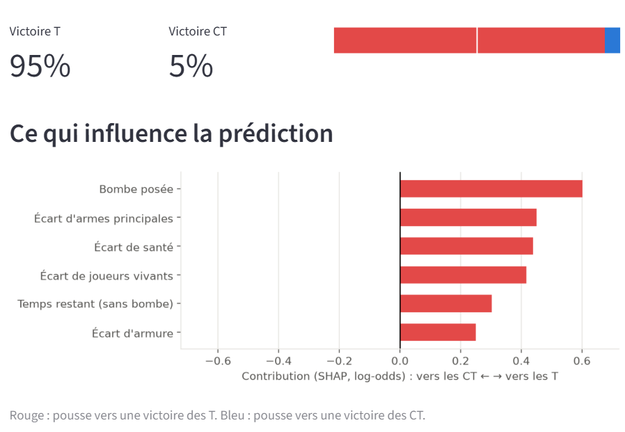
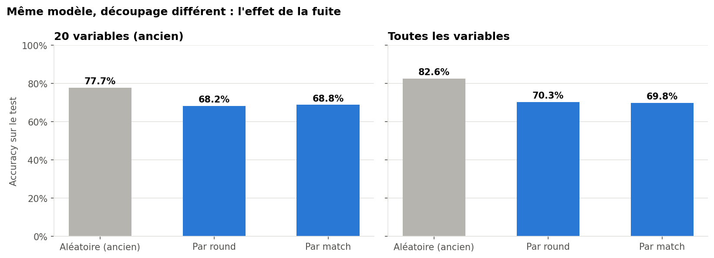
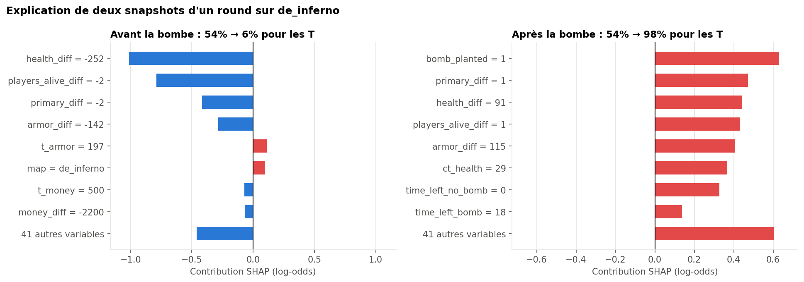
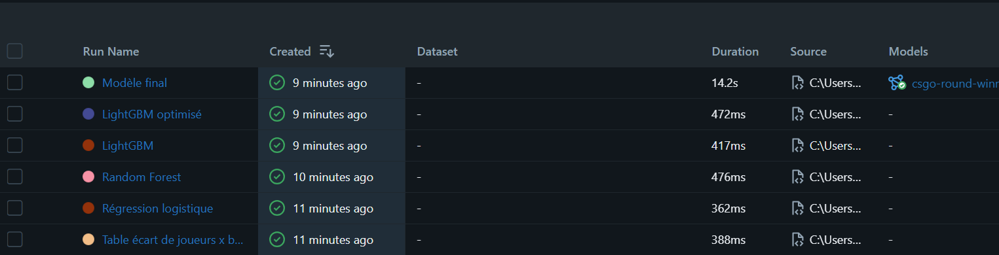

# CS:GO Round Winner – Probabilité de victoire d'un round

[](https://github.com/louchenilounes/csgo-round-winner/actions/workflows/ci.yml)

Estimer, à n'importe quel moment d'un round de CS:GO, la probabilité de victoire de chaque équipe à partir de l'état de la partie : joueurs vivants, santé, armure, équipement, argent, bombe, temps restant, carte.

Le projet couvre toute la chaîne : nettoyage et reconstruction des données, évaluation sans fuite, modélisation, interprétation, suivi des expériences, API, interface et intégration continue.



## Résultats

Évaluation finale sur **141 matchs jamais vus** (24 978 snapshots), intervalles de confiance à 95 % par bootstrap sur les matchs :

| Modèle | Accuracy | ROC-AUC | Log loss | Brier |
| --- | --- | --- | --- | --- |
| Meilleure règle simple (joueurs vivants + bombe) | 63,9 % | – | – | – |
| **LightGBM optimisé** | **70,8 %** [69,7 ; 72,0] | **0,806** [0,795 ; 0,816] | **0,513** | **0,176** |

- Les probabilités sont **bien calibrées** (ECE = 0,017) : quand le modèle annonce 70 %, l'équipe gagne environ 70 % du temps.
- Le score du test est conforme à l'estimation par validation croisée (71,1 %), ce qui valide le protocole.
- La précision dépend fortement du moment du round : **60 %** au début (5 contre 5, issue très incertaine), **86 %** dans les 40 dernières secondes.

## Points clés du projet

### 1. Une fuite de données qui gonflait les scores

Le dataset contient environ 6,5 snapshots par round, tous avec le même gagnant. Un découpage aléatoire place des snapshots d'un même round dans l'entraînement et dans le test : le modèle reconnaît le round au lieu de comprendre la situation. Les rounds et les matchs ont été reconstruits (le dataset ne les fournit pas), puis le découpage a été fait **par match**.



À modèle identique, l'accuracy passe de 82,6 % (découpage aléatoire) à 69,8 % (découpage par match) : près de 13 points étaient artificiels.

### 2. Une erreur d'étiquette dans le dataset

Le premier snapshot de chaque round porte le gagnant du round **précédent**. Vérification indépendante : le gagnant déduit du score suivant correspond à l'étiquette du dernier snapshot dans 99,2 % des cas, contre 63,9 % pour le premier. 6 763 lignes (5,5 %) ont été corrigées.

### 3. Un modèle interprétable

Les valeurs SHAP (calculées nativement par LightGBM) montrent que le modèle s'appuie sur les écarts entre équipes (armes principales, armure, joueurs vivants, santé) et qu'il a appris l'interaction entre le temps restant et la bombe.



## Données

CS:GO Round Snapshots, publié sur OpenML ([fichier source](https://www.openml.org/data/download/22102255/dataset)) : 122 410 snapshots pris environ toutes les 20 secondes pendant des matchs professionnels, 96 variables. Après reconstruction : 701 matchs et 18 703 rounds.

## Démarche

| Notebook | Contenu |
| --- | --- |
| `01_chargement_donnees` | Chargement, typage, contrôles de qualité |
| `02_eda` | Analyse exploratoire : cartes, bombe, joueurs vivants, économie, temps |
| `03_rounds_et_fuite` | Reconstruction des rounds et matchs, correction des étiquettes, mesure de la fuite |
| `04_feature_engineering` | 49 variables (écarts entre équipes, armes par catégorie, temps × bombe) dans un pipeline scikit-learn |
| `05_baselines` | Comparaison à des règles simples et tables de fréquences |
| `06_modeles_avances` | Régression logistique, Random Forest, MLP, gradient boosting ; optimisation de LightGBM avec Optuna |
| `07_evaluation_finale` | Test, bootstrap par match, calibration, analyse des erreurs |
| `08_interpretation_shap` | Importance globale, effets, explications locales |

Toutes les comparaisons de modèles se font par validation croisée groupée par match (`GroupKFold`) sur le train ; le test n'est utilisé qu'une fois, pour l'évaluation finale. `00_notebook_initial` est la première version du projet, conservée pour comparaison.

## Limites et pistes

- Les snapshots ne disent pas **où** sont les joueurs ni quelles grenades ont été utilisées : en début de round, l'issue reste peu prévisible avec ces seules informations.
- Les rounds longs comptent plus de snapshots et pèsent donc davantage dans l'entraînement ; une pondération par round pourrait être testée.
- Le dataset date de CS:GO ; une validation sur des données de Counter-Strike 2 serait nécessaire avant tout usage actuel.

## Installation

```bash
git clone https://github.com/louchenilounes/csgo-round-winner.git
cd csgo-round-winner
python -m venv .venv
.venv\Scripts\Activate.ps1      # Windows (PowerShell)
# source .venv/bin/activate     # Linux / macOS
pip install -r requirements.txt
```

## Reproduire les résultats

```bash
python -m src.data          # télécharge les données et affiche le rapport de qualité
python -m src.rounds        # reconstruit rounds et matchs, crée le découpage train/test
python -m src.experiments   # expériences principales + modèle final, suivis dans MLflow
```

Les notebooks `01` à `08` détaillent chaque étape. Les hyperparamètres retenus sont dans `reports/best_params_lightgbm.json`.

## Suivi des expériences (MLflow)

```bash
mlflow ui --backend-store-uri sqlite:///mlflow.db
```



Chaque run enregistre ses paramètres et ses métriques de validation croisée ; le modèle final est versionné dans le Model Registry avec son pipeline complet.

## Démo

**Interface Streamlit** : on règle une situation de jeu et l'application affiche la probabilité de victoire et les facteurs qui l'expliquent.

```bash
streamlit run app/streamlit_app.py
```

**API FastAPI** (documentation interactive sur http://127.0.0.1:8000/docs) :

```bash
uvicorn app.api:app --reload
```

```bash
curl -X POST http://127.0.0.1:8000/predict -H "Content-Type: application/json" \
     -d '{"map": "de_inferno", "time_left": 25, "bomb_planted": true,
          "ct": {"players_alive": 2}, "t": {"players_alive": 3}}'
```

Les champs non renseignés prennent des valeurs cohérentes avec le nombre de joueurs vivants ; les situations impossibles sont refusées avec un message explicite (code 422).

**Docker** (API sur le port 8000, interface sur le port 8501) :

```bash
docker compose up --build
```

## Qualité du code

```bash
python -m pytest                              # 61 tests
ruff check src app tests scripts
ruff format --check src app tests scripts
```

À chaque push, GitHub Actions lance l'analyse statique et les tests, puis construit l'image Docker, la démarre et interroge l'API (avec un petit modèle entraîné sur des données synthétiques, le modèle réel n'étant pas versionné).

## Structure du projet

```
csgo-round-winner/
├── app/
│   ├── api.py                 # API FastAPI (/health, /predict)
│   └── streamlit_app.py       # interface Streamlit
├── notebooks/                 # 00 à 08 : analyse, modélisation, évaluation
├── reports/                   # figures, tableaux de résultats, hyperparamètres
├── scripts/make_ci_model.py   # modèle synthétique pour la CI
├── src/
│   ├── data.py                # téléchargement, lecture ARFF, contrôles
│   ├── rounds.py              # rounds, matchs, étiquettes, découpage train/test
│   ├── features.py            # variables et pipelines scikit-learn
│   ├── evaluation.py          # validation croisée groupée, métriques
│   ├── baselines.py           # références simples
│   ├── tuning.py              # optimisation Optuna
│   ├── train.py               # modèle final
│   ├── final_eval.py          # bootstrap, calibration
│   ├── explain.py             # valeurs SHAP
│   ├── tracking.py            # MLflow
│   ├── experiments.py         # relance des expériences
│   ├── serving.py             # situation de jeu -> prédiction expliquée
│   └── ...                    # config, eda, leakage, viz
├── tests/                     # pytest
├── .github/workflows/ci.yml   # intégration continue
├── Dockerfile, docker-compose.yml
├── requirements.txt           # environnement complet
└── requirements-app.txt       # dépendances de l'image Docker
```
